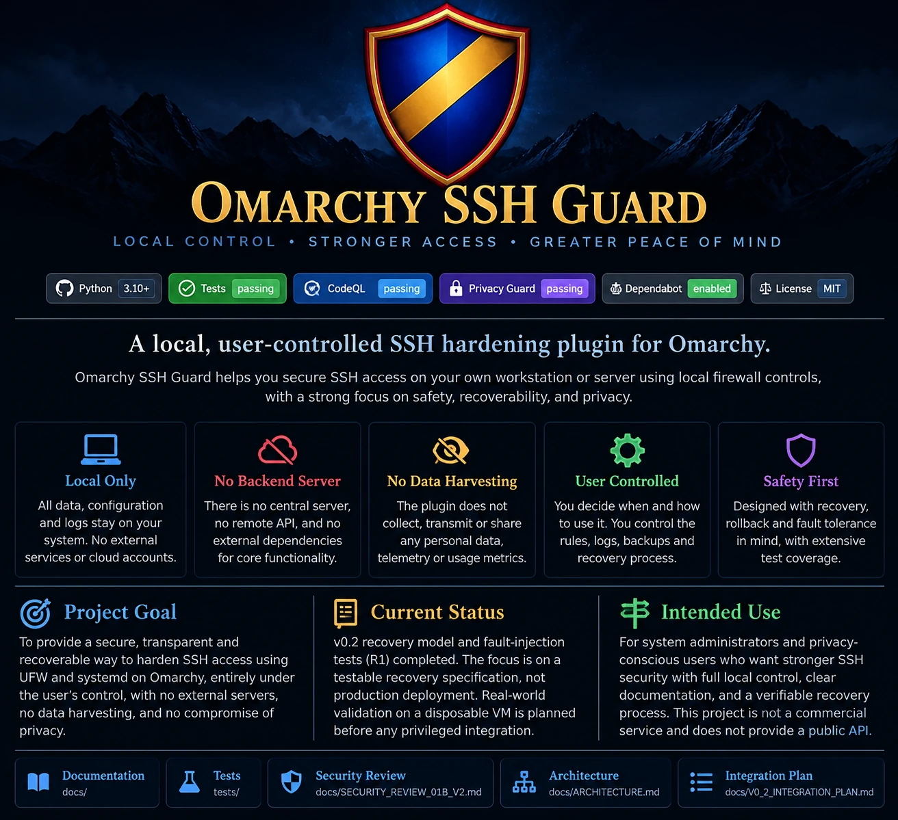

<div align="center">


# Omarchy SSH Guard


**Local security insight. User-controlled operation. Recovery before restriction.**

</div>

**A local, read-only SSH/UFW/Docker exposure inspector and optional Omarchy desktop widget.**

> **Prototype v0.1.0 — not a security certification or automated firewall hardener.** The CLI never installs firewall rules, restarts services, edits keys, changes SSH configuration, or calls a privileged deployment helper. Its verdict is always **NOT VERIFIED** because an on-host inspection cannot prove external reachability or safe remote recovery.

Built for Omarchy 4.x systems with UFW, OpenSSH and optionally Docker. It is intentionally independent of any research project, device, user account, SSH key, private network, or GitHub credential.

## At a glance

| Capability | In v0.1.0 | Limit |
| --- | --- | --- |
| UFW enabled/default inbound policy | Yes | Requires permission to read UFW state |
| Broad inbound SSH permits (IPv4/IPv6) | Yes | Checks UFW's displayed rules; no full packet-path proof |
| Source-specific SSH rule count | Yes | Does not print authorized addresses |
| SSH wildcard TCP/22 listener | Yes | Listener is not proof of reachability |
| Docker host port bindings | Yes | Summarizes loopback/non-loopback; needs Docker socket permission |
| SSH hardening checklist | Yes | Plan only; no mutations |
| Omarchy bar widget | Yes | Static instructions; no subprocesses, networking or privilege requests |
| Independently verified remote access | No | Must be tested from separate controlled clients |
| Timed rollback, firewall apply and finalize | No | Planned future audited component |

### Why this project exists

An SSH service bound to `0.0.0.0:22` or `[::]:22` may be appropriately protected by source-specific firewall rules—or may be exposed more broadly than intended. `ufw limit 22/tcp` is rate limiting, **not** a client allowlist. Docker can also publish ports through packet paths that bypass ordinary UFW `INPUT` rules. These are configuration concerns, not proof of compromise.

The goal is to help operators **inspect, document, and independently verify** their own systems without bundling hazardous one-command hardening or private deployment material.

### Project goal and intent

Omarchy SSH Guard is designed for transparent, locally controlled SSH security on Omarchy. The immediate purpose is to explain what the local firewall, SSH listener and optional Docker configuration show **without changing them**. Its long-term research direction is safe, independently verifiable SSH restriction backed by recoverable transactions, explicit operator consent and tested rollback.

This project is **not** a hosted monitoring service, a cloud management platform, a centralized policy engine or a one-click privileged hardening tool. Stronger controls will remain separate and blocked until independent evidence and recovery tests establish their safety.

### Local-first privacy and user control

| Property | Current behavior |
| --- | --- |
| **No backend server** | No project-operated server, cloud account, remote API, login or hosted dashboard is required to run the plugin, CLI or optional offline linter. |
| **No data harvesting** | No application telemetry, analytics, hidden upload, behavioral tracking or remote collection endpoint is implemented. |
| **Local inspection** | The read-only CLI invokes local host utilities and returns aggregate counts and limited booleans, not a raw inventory of names, IP addresses, accounts or SSH keys. |
| **User-controlled output** | Audit results are printed locally. The user decides whether and where to save, inspect, remove or share them. |
| **User-controlled input and storage** | The evidence linter reads a JSON file from an explicitly supplied local path; it does not rewrite or upload it. No centralized evidence database or credential store is created. |
| **No automatic networking** | The widget, audit CLI and linter have no application-level network-upload functionality. Cloning source, optional updates, contributing on GitHub and CI are separate development/distribution activities. |

**The plugin does not run a background collection agent or upload personal system data.** Host configuration and any local evidence remain under the operator's control. External software used for installation or diagnostics (such as GitHub, an OS package manager, or Docker) may have its own independent behavior; this repository cannot guarantee their privacy practices. These statements describe the reviewed code and design, **not a formal security certification**.

<p align="center">
  
</p>

<p align="center"><sub>Project overview graphic. Its status labels are illustrative, not a live security verdict or evidence of deployed SSH hardening.</sub></p>

## Requirements

- An Omarchy 4.x desktop for the optional QML widget (validate against your exact installation).
- Python 3.10+ and standard-library modules for the CLI.
- `ufw` and `ss` for host firewall and listener inspection; `docker` is optional.
- A terminal. **Do not invoke the user-installed CLI through sudo.** User-writable code should not be executed with root privileges.
- The widget and CLI need no project account, GitHub token, runtime Internet access or SSH keys. The CLI uses Python's standard library; downloading source and running hosted CI are separate activities.

## Review and install

Inspect source before activating any shell plugin. Omarchy third-party plugins run code in the user's long-lived desktop shell without a general-purpose sandbox.

```bash
git clone https://github.com/LcosmosS/Omarchy-SSH-Guard.git
cd Omarchy-SSH-Guard
./scripts/check.sh
./scripts/install-local.sh
```

The installer only copies the CLI into `~/.local/bin/omarchy-guard`. It **does not** install a privileged executable, modify services, add sudoers permissions, or enable the desktop widget. Ensure `~/.local/bin` is on your `PATH`, or invoke the full path.

Run an unprivileged audit:

```bash
omarchy-guard audit
omarchy-guard audit --json
```

Create a **non-executable** hardening checklist using a documentation-only address:

```bash
omarchy-guard plan --ssh-source 198.51.100.25/32
```

The example address is from the reserved documentation range. Substitute your own permitted SSH source *locally* and do not upload the resulting plan. The `plan` command accepts only a **single host** (`/32` for IPv4, `/128` for IPv6), to avoid accidental network-wide permission suggestions.

### Optional Omarchy widget

The widget is an informational bar item; **it does not run the CLI**. From a reviewed checkout on Omarchy:

```bash
omarchy plugin validate .
omarchy plugin add https://github.com/LcosmosS/Omarchy-SSH-Guard.git
omarchy plugin enable community.omarchy-ssh-guard
```

You can also use `omarchy plugin add https://github.com/LcosmosS/Omarchy-SSH-Guard.git --enable` after reviewing this public source. For local QML linting, if `qmllint` is installed:

```bash
qmllint -I "$OMARCHY_PATH/shell" BarWidget.qml Panel.qml
```

The widget deliberately displays **NOT VERIFIED**, even when an audit finds default-deny incoming traffic or no broad SSH permits.

## Interpreting results

Representative **illustrative** output:

```text
Omarchy SSH Guard | audit only | security verdict: NOT VERIFIED
ufw: {"observed": true, "active": true, "default_deny_incoming": true}
ssh_firewall: {"observed": true, "global_ipv4_allow": false, "global_ipv6_allow": false, "source_specific_rule_count": 1}
ssh_listener: {"observed": true, "wildcard_port_22": true}
docker_ports: {"observed": false}
external_reachability: {"observed": false, "reason": "requires independent network tests"}
```

- **`observed: false` means unknown**, not secure. UFW and Docker may deny unprivileged inspection.
- **`global_*_allow: false`** means the known UFW rule output contained no matching *broad* TCP/22 `ALLOW IN`/`LIMIT IN` entry. Other rules, routes, IPv6 handling, NAT, upstream networking and application policy remain outside this conclusion.
- **`wildcard_port_22: true`** describes a listening socket; it does not establish internet-wide accessibility.
- **`loopback_published`** counts container publications such as `127.0.0.1:5432->5432/tcp`; **`nonloopback_published`** counts wildcard publications. Port text can be incomplete; unknown publications are explicitly counted.
- **`verdict: NOT_VERIFIED`** is intentional. A meaningful security assessment requires external tests, package review, and operational recovery testing.

The CLI output intentionally omits usernames, real IPs, hostnames, SSH keys, container names, environment variables, authorization files and full UFW listings. It never sends data to a server. If you share its output publicly, review it first.

## Safe SSH hardening runbook (manual, NOT automated)

**Do not remove existing remote-access rules solely because a local audit reports an issue.** Operators who need to narrow port 22 should follow the read-only guidance in [`docs/SSH_HARDENING.md`](docs/SSH_HARDENING.md).

At a minimum:

1. Identify **every** inbound authorized SSH source, including recovery endpoints. Preserve local keyboard/display recovery.
2. Verify the server's SSH host-key fingerprint out of band, then test a *fresh* authorized public-key login. Do not weaken host-key checking to make a test pass.
3. Audit effective `sshd` policy (password, keyboard-interactive and root authentication) without silently changing it.
4. Take a root-protected firewall backup; independently check restoration mechanics.
5. Prepare and **arm** an automatic rollback **before** touching UFW. Ensure that the rollback is outside a user-writable location.
6. Add authorized source rules, remove broad IPv4/IPv6 rules only with explicit approval, and keep an independent management session available.
7. Test **fresh permitted login** and **rejection from independent unauthorized IPv4 and IPv6 clients**. Record accurate baseline and post-change timestamps, destinations, source addresses and network path. A self-test from the protected host does not replace these.
8. Finalize only after a verifier accepts genuine evidence and stops the rollback; otherwise let it execute and check the restored firewall state.

A rollback that restores broad access is a **successful recovery test**, not a completed hardening deployment. Do not defeat the timer or forge evidence to reach a green status.

## Docker-specific caveats

Docker can redirect published-port traffic before the UFW rules normally applied to local traffic. Review `docker ps --format 'table {{.Names}}\t{{.Ports}}'` and your Compose effective configuration. For services that must be accessible only to the host, prefer explicit loopback bindings:

```yaml
services:
  example-api:
    ports:
      - "127.0.0.1:8000:8000"
```

This is a generic example, **not** a patch to a real deployment. Verify Docker version, host networking, IPv6 publications, routing and any `ufw-docker` integration. Never disable Docker-managed firewall rules casually. Docker access for a user may confer root-equivalent privileges; do not add your account to the `docker` group just to run this audit.

Reference: [Docker's packet filtering and UFW documentation](https://docs.docker.com/engine/network/packet-filtering-firewalls/).

## Files and trust boundaries

```text
manifest.json              Omarchy plugin metadata
BarWidget.qml              Informational bar widget
Panel.qml                  Informational panel
bin/omarchy-guard          Unprivileged, stdlib-only audit/plan CLI
bin/omarchy-guard-evidence Optional, unprivileged offline evidence linter
schemas/ssh-evidence-v2.schema.json  Reviewed evidence format
tests/support/recovery_model.py      Test-only R1 reference model
tests/test_recovery_fault_matrix.py  R1 synthetic fault suite
assets/omarchy-ssh-guard-shield.svg  Self-hosted shield logo
assets/omarchy-ssh-guard-badge.svg   Self-hosted branding badge
scripts/check.sh           Offline test + metadata validation
scripts/install-local.sh   Local user-level CLI copy only
tests/test_guard.py        Deterministic parser and negative tests
docs/SSH_HARDENING.md      Manual, rollback-first security runbook
SECURITY.md                Security policy and responsible reporting
CONTRIBUTING.md            Contribution and privacy rules
.github/workflows/ci.yml  Unprivileged GitHub Actions smoke tests
```

No deployment helper, evidence collector, credentials, IP allowlist or host-specific transaction files are supplied in this version. The plugin and CLI have distinct trust boundaries; the widget never invokes a privileged process.

## Read-only v0.2 evidence schema — merged PR #3

[PR #3](https://github.com/LcosmosS/Omarchy-SSH-Guard/pull/3) added a generic evidence schema and optional offline linter to the repository. The linter does not change the installed v0.1.0 widget, audit CLI or installer. The SSH-HARDEN-01b privileged collector/executor remains **blocked** by the [security review](docs/SECURITY_REVIEW_01B_V2.md).

From a reviewed source checkout, as an ordinary user:

```bash
python3 -B bin/omarchy-guard-evidence /private/local/example.json
```

This checks structure and supplies local-clock diagnostics. It never verifies
signatures, consults a journal, probes a network or authorizes deployment. Every
verdict remains `NOT_VERIFIED`; exit 0 means structurally valid, including
incomplete bundles. Keep real inputs outside the checkout. The linter is not
installed by `install-local.sh` or invoked by the widget or audit CLI.

See the [architecture and threat model](docs/ARCHITECTURE.md),
[integration plan](docs/V0_2_INTEGRATION_PLAN.md), and
[test report](docs/TEST_REPORT_01B_V2.md). CI also runs mandatory independent
schema checks using development-only packages pinned in `requirements-schema.txt`.
The default CLI and optional linter need only Python's standard library.

## SSH-HARDEN-R1 recovery safety model — PR #5

[PR #5](https://github.com/LcosmosS/Omarchy-SSH-Guard/pull/5) contains a **test-only recovery research model**, not a released or deployed recovery service. R1 specifies a fail-safe recovery transaction model and exercises synthetic storage, timers, rollback states, interrupted commits and cleanup. It includes:

- [Recovery state-machine specification](docs/RECOVERY_STATE_MACHINE.md)
- [Reference model](tests/support/recovery_model.py) and [fault-injection tests](tests/test_recovery_fault_matrix.py)
- [R1 validation report](docs/RECOVERY_R1_REPORT.md) and independent review checklist
- [Future disposable-VM protocol](docs/RECOVERY_VM_VALIDATION.md), with **all 28 VM cases NOT RUN**

The R1 classification is **REFERENCE_MODEL_VALIDATED**, limited to offline synthetic behavior. Sourcery and CodeRabbit review produced further correction tests on the PR branch. It **does not** establish real UFW/systemd recovery, independent network observations, storage/power-loss durability or readiness for deployment. F02–F05 still require real integration and VM evidence, while F01 (fabricated external rejection evidence) remains a separate unresolved blocker.

**PR #5 does not add a privileged executor, background agent, hosted backend, automatic firewall mutations, or deployment authority.** The v0.1.0 plugin remains read-only.

## Tests and CI

```bash
./scripts/check.sh
python3 -m unittest discover -s tests -v
python3 -m py_compile bin/omarchy-guard
python3 -m json.tool manifest.json >/dev/null
```

CI runs the deterministic Python tests. **Passing CI does not validate the live firewall**, Omarchy's QML runtime, independent access or rollback. Run `omarchy plugin validate .` on an actual Omarchy host; test widget enable/disable manually.

## Removal

```bash
omarchy plugin disable community.omarchy-ssh-guard
omarchy plugin remove community.omarchy-ssh-guard
rm -f "$HOME/.local/bin/omarchy-guard"
```

No daemon or firewall cleanup is necessary: none was installed by this repository. Removing this plugin does **not** undo firewall changes performed manually or by unrelated tools.

## Privacy and vulnerability reporting

Public pull requests must contain **synthetic fixtures only**. Do not commit real source addresses, credentials, key fingerprints, SSH authentication logs, host identifiers, database configuration, private evidence bundles, backup archives, or operational transaction details. Use GitHub's private vulnerability-reporting mechanism (if enabled) for sensitive disclosures; see [`SECURITY.md`](SECURITY.md).

## Roadmap

- v0.1: safe read-only inspection, non-executable runbook, informational Omarchy widget.
- Read-only v0.2 schema/linter (merged PR #3): operator-supplied local evidence, structural diagnostics only, always `NOT_VERIFIED`.
- R1 (PR #5): non-production recovery reference model, fault-injection tests and **28 future, unexecuted** VM cases.
- Future R2: independently reviewed disposable-VM adapter and real recovery, power-cut, systemd and dual-stack network validation.
- Possible future privileged component (not authorized): local and root-owned only after independent evidence-authority and recovery validation, with explicit user consent and fail-closed rollback.

**Status:** community prototype; no independent penetration test, no security guarantee and no endorsement by Omarchy.

## References

- [Omarchy shell plugin manual](https://omarchy.org/manual/shell-plugins/)
- [Docker packet filtering and UFW](https://docs.docker.com/engine/network/packet-filtering-firewalls/)
- [OpenSSH sshd_config manual](https://man.openbsd.org/sshd_config)
- [UFW manual](https://manpages.ubuntu.com/manpages/noble/man8/ufw.8.html)


## Repository governance and automated security checks

The security-focused source remains **read-only**: no SSH/UFW system changes, credential handling, or privileged evidence-engine integration are added by the governance workflows.

- [Code ownership](.github/CODEOWNERS) and the [ownership change log](docs/CODEOWNERS_LOG.md) list both `@LcosmosS` and `@LibertySquared`; the active main-branch ruleset requires independent approval.
- [Privacy guard](.github/workflows/privacy.yml) checks committed text and paths against common private-artifact, token, local-address and personal-email patterns. It is heuristic and may miss other sensitive data. Do not upload operational backups or keys.
- [CodeQL](.github/workflows/codeql.yml) analyzes Python and GitHub Actions workflows on PRs, main-branch pushes and a schedule. **QML is not covered**.
- [Dependabot](.github/dependabot.yml) proposes GitHub Actions updates.
- [Ruleset review](docs/RULESET_REVIEW.md) documents staged activation; the ruleset now actively requires required checks, code-owner review and squash merging to `main`.

GitHub CI is a **remote source-development safeguard**, not a runtime backend or telemetry service. Passing it does not attest to a deployed firewall, prove network isolation or unblock rejected privileged integration.

## License

MIT — see [`LICENSE`](LICENSE).
