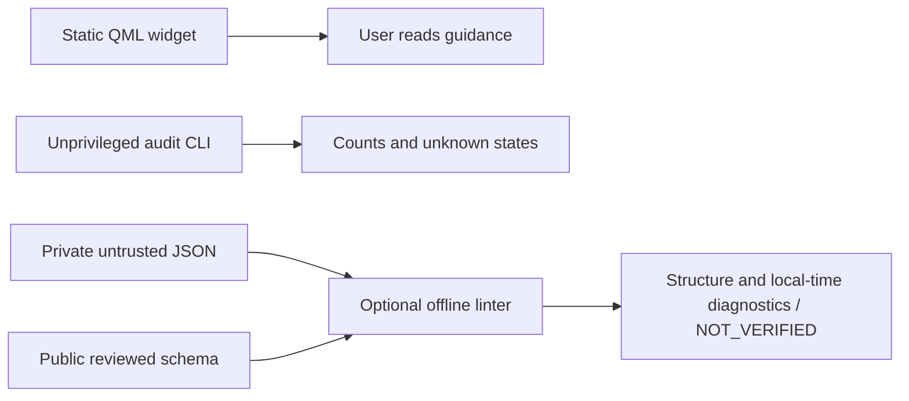

# v0.2 proposal: architecture and security threat model

Status: local review proposal, not a release. The installed plugin remains the
existing read-only v0.1 plugin. No privileged executor or collector is included.

## Components and authority

There is no path from the widget, audit CLI or linter to a privileged deployment
helper. The widget does not invoke either CLI. The existing installer still copies
only `bin/omarchy-guard` to the user's local bin. The optional evidence linter is
run from a reviewed source checkout with Python; it is not automatically installed,
activated or called by audit. Version metadata remains v0.1.0 pending review.

The linter reads one explicitly supplied local JSON document and the repository's
fixed schema. It has no network, subprocess, signing, key-enrollment, journal,
backup, firewall, systemd or persistent evidence-store API. It refuses root at its
CLI boundary. Functions are ordinary Python functions, not a sandbox against a
caller deliberately importing them as root. Source installed under a user's
control must never be executed through sudo.

## Data model and assurance vocabulary

The public schema supports the candidate's `challenge`, `report`, and `bundle`
wire shapes. The legacy milestone string identifies that interchange dialect;
it does not authorize a deployment or bind a real host. Challenges contain run
and challenge UUIDs, a nonce, policy digest, client role, address family, endpoints,
path description and explicit UTC lifetime. Reports contain a full challenge,
claimed socket/result/timing data and a MAC field. Bundles group observations and
can intentionally be incomplete.

These concepts must remain separate:

| Property | Meaning | v0.2 proposal |
| --- | --- | --- |
| JSON structure | Required fields, types, lexical formats and closed objects | Checked |
| Local time window | Supplied timestamps fit the local wall-clock collection window | Diagnostic only |
| MAC authentication | Bytes authenticate under an enrolled HMAC secret | Not checked; no key is read |
| Provenance | An independently trusted observer produced the measurement | Not established |
| Journal correlation | Exact current-run server event matches the connection | Not checked |
| Network reachability | Traffic actually traversed the specified independent path | Not established |
| Deployment authorization | A reviewed transaction may retain its restriction | Always false |

Every successful lint output includes `verdict=NOT_VERIFIED`,
`external_reachability=NOT_VERIFIED`, `signature=NOT_CHECKED`,
`journal=NOT_CHECKED`, `run_binding=NOT_CHECKED`, and
`deployment_authorized=false`. A zero exit status means structural lint completed.
Even a bundle with operator attestation or a plausible signature has no additional
authority. Incomplete/contradictory semantic claims can be structurally valid.
The linter cannot verify actual deployment run binding, baseline completeness,
endpoint ownership, authorization policy or any cryptographic claim.

Local time diagnostics check challenge lifetime (at most 900 seconds), UTC issue
and expiry, a five-second start allowance, report duration (at most 45 seconds)
and future completion, and bundle creation within one hour. Report challenges
must still be current for `local_time_window=CURRENT`. Expired historical reports
may be structurally valid with `STALE_OR_FUTURE`; that label does not adjudicate
their historical authenticity. No transaction or policy is consulted.

## Parsing and file access

Input is capped at 256 KiB, nesting at 32 levels, decoded as UTF-8, and parsed with
duplicate-key and explicit nonfinite-number rejection. The Linux reader walks
each path component with pinned directory descriptors and `O_NOFOLLOW`, rejects
parent traversal, and opens only a regular leaf with `O_NONBLOCK`. A directory
renamed after opening cannot redirect its pinned descriptor. It rejects FIFO and
device leaves. Reads are bounded even if a file grows after fstat. Concurrent
writers can still change the document being read; the output is a diagnostic,
not an authorization snapshot.

The restricted stdlib validator accepts only the reviewed schema's keywords and
local references. Unknown visited keywords fail closed; this is not a general
JSON Schema engine. Canonical lower-case UUIDs, compressed IP text without scope
IDs, explicit UTC with at most six fractional digits, and JSON integer encodings
are intentionally stricter than general Draft 2020-12. The public schema's
patterns are explicitly anchored, including against a trailing newline.
Independent CI validates the meta-schema and representative positive/negative
instances with a real Draft 2020-12 engine and installed date/IP/UUID checkers.
Schema conformance does not cover duplicate JSON text keys; the parser does.

Only fixed status strings and the validated object kind are printed. Endpoints,
paths, signatures, network descriptions and exception payloads are not echoed.
Input files are never rewritten or uploaded. The linter makes no claim about
input ownership/permissions: it is an unprivileged diagnostic for untrusted data.

## Assets, attackers and trust assumptions

Assets include remote recovery, firewall integrity, authentic evidence, signing
credentials, SSH host/user keys, endpoint privacy, and public source integrity.
The linter's asset is narrower: privacy-preserving inspection that cannot be
mistaken for permission to mutate the host.

| Actor or failure | Capability | Boundary and response |
| --- | --- | --- |
| Untrusted evidence submitter | Alter JSON, paths, results, timestamps or signatures | Strict bounded parsing; no execution; no positive security verdict |
| Local unprivileged process | Replace accessible input, create symlinks/FIFOs, race path traversal | Descriptor-based input walk and bounded read; private runtime outside checkout |
| Dishonest enrolled client | Possess legitimate HMAC key and invent negative outcomes | Authentication never promoted to independent truth; no collector integrated |
| Network attacker | Drop TCP but allow ICMP, reroute, spoof unauthenticated banners | Network evidence is outside lint authority; independent observation needed |
| SSH user/configuration | Modify client configuration or returned shell output | No client execution in v0.2; future client requires reviewed config and witnesses |
| Journal loss or forged message | Missing records or untrusted text resembling sshd | No journal acceptance in v0.2; future verifier needs trusted metadata and coverage |
| Power loss/clock jump/disk failure | Interrupt publication, deadline or finalization | Executor excluded; VM recovery gates required before adding one |
| Malicious dependency/contributor | Change executable, schema or CI behavior | Review source/diff, pin CI dependencies, preserve read-only authority |
| Privileged administrator/kernel | Read keys, replace binaries/state or control journal | Trusted computing base; no claim of resistance to compromised root/kernel |

Local Python/OS, the reviewed checkout/schema and the terminal's confidentiality
are trusted for this diagnostic. An adversary who can edit the linter itself can
change its behavior. A hostile Python runtime, exhausted system resources and
kernel vulnerabilities are outside the claimed boundary. CI package installation
is for development only; no runtime account or dependency download is required.

## Public source versus private runtime

| Material | Public checkout | Private location and access |
| --- | --- | --- |
| Generic schema/code/docs and synthetic tests | Allowed after review | Source package separate from runtime |
| Client source addresses, login users, target identity and reviewed policy | Never | Future `/etc/omarchy-ssh-guard/`, root-owned 0700 directory / 0600 files |
| Server verifier keys/trust records | Never | Same protected config tree; asymmetric design should retain public verification material only where practical |
| Client signing secret | Never | Corresponding client private store, owner-only directory/file; never shared with other clients |
| Challenges/reports/journal witnesses | Never | Future `/var/lib/omarchy-ssh-guard/`, root-owned 0700 / 0600, run-scoped |
| Backups/transaction state/receipts | Never | Protected state tree, explicit retention, encryption as needed; outside source and shared sync trees |
| Installed privileged code, if ever approved | Public source only | Future root-owned `/usr/lib/omarchy-ssh-guard/`; no runtime write permission or checkout execution |
| Unit definitions, if ever approved | Generic templates only | Root-owned `/etc/systemd/system/`; no client secrets in units, argv or journal |

These are future boundaries, not directories created by this patch. Public tests
generate documentation-only endpoints and placeholder identifiers in memory.
They never load the audit directory, live journals, user keys or production state.
No real host-key fingerprint is retained in test fixtures. HMAC fields in synthetic
JSON are placeholders, not usable signing keys. Ignore rules are defense in
depth; `git add -f` bypasses them and cannot replace a content review. Never put
private runtime in a clone, worktree, build context, CI artifact or public PR.

## Required future executor invariants

This proposal implements none of these privileged transitions. Any future design
must specify durable states for preparation, rollback arming, mutation, pending
verification, commit decision, cleanup and rollback, with boot reconciliation.
Every possible interruption point must have a defined next action. In particular:

1. A minimal protected recovery program and durable recovery inputs must exist
   before restriction. Evidence tooling failures must not block restoration.
2. Run IDs must bind timer invocation, loaded unit contents, policy and persisted
   state. An elapsed active timer is not an armed future deadline.
3. Deadlines need wall/boot/monotonic behavior under reboot, suspend and clock
   changes; a persistent calendar timer is only one component.
4. Finalization must persist a valid commit decision and reconcile cancellation
   without an ambiguous crash gap. Its result must reflect observed manager state.
5. Repeating recovery must restore the intended access and retry cleanup safely.
   Old timers and retries must never affect a different run.
6. An authenticated self-report must never by itself authorize retaining a
   restriction. Evidence assurance and operator authorization need explicit scopes.
7. Installation, package integrity, environment sanitization and private storage
   must be established before executing root code; self-checking afterward is
   insufficient.

The baseline, attack surface and missing tests motivating these constraints are
in [the candidate review](SECURITY_REVIEW_01B_V2.md).
